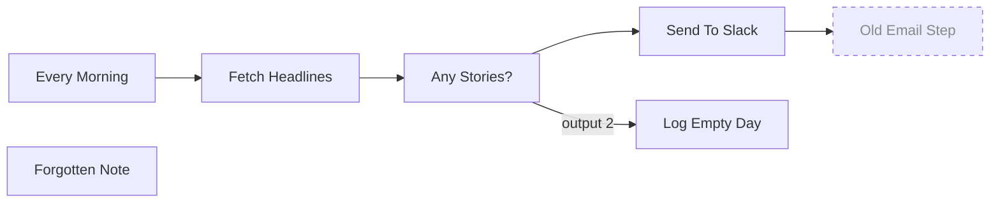

# Daily News Digest

> Generated by [n8n-docgen](https://github.com/vinuthan01/n8n-docgen). Do not edit by hand.

## Overview

- **Nodes:** 7 (1 disabled)
- **Triggers:** Every Morning (`scheduleTrigger`)
- **Node types used:** `emailSend`, `httpRequest`, `if`, `noOp`, `set`, `slack`
- **Credentials:** slackApi (My Slack)
- **Active:** yes

## Diagram

## Steps

1. **Every Morning** (`scheduleTrigger`)
   - Goes to: Fetch Headlines
2. **Fetch Headlines** (`httpRequest`)
   - Note: Pulls the top stories from a public news API.
   - Settings: `url: https://example.com/api/top-stories`, `method: GET`
   - Goes to: Any Stories?
3. **Any Stories?** (`if`)
   - Goes to: Send To Slack, Log Empty Day (output 2)
4. **Send To Slack** (`slack`)
   - Settings: `channel: #news`, `text: ={{ $json.summary }}`
   - Goes to: Old Email Step
5. **Log Empty Day** (`set`)
   - Settings: `mode: manual`
6. **Old Email Step** (`emailSend`) *(disabled)*
7. **Forgotten Note** (`noOp`)

## Node reference

| Node | Type | Disabled |
| --- | --- | --- |
| Every Morning | `scheduleTrigger` | no |
| Fetch Headlines | `httpRequest` | no |
| Any Stories? | `if` | no |
| Send To Slack | `slack` | no |
| Log Empty Day | `set` | no |
| Old Email Step | `emailSend` | yes |
| Forgotten Note | `noOp` | no |

## Warnings

- **Forgotten Note** is not connected to anything.
- **Old Email Step** is disabled and will not run.
- **Fetch Headlines** has a hardcoded value in `apiKey`. Move it to an n8n credential.
